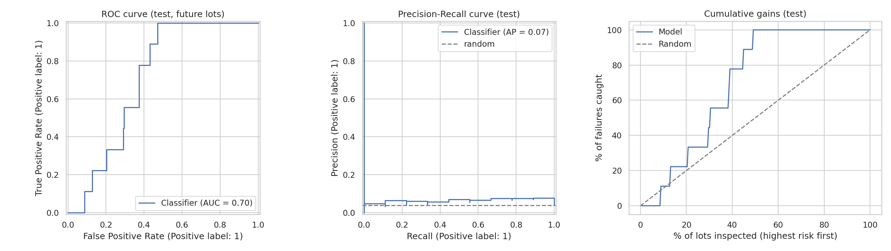
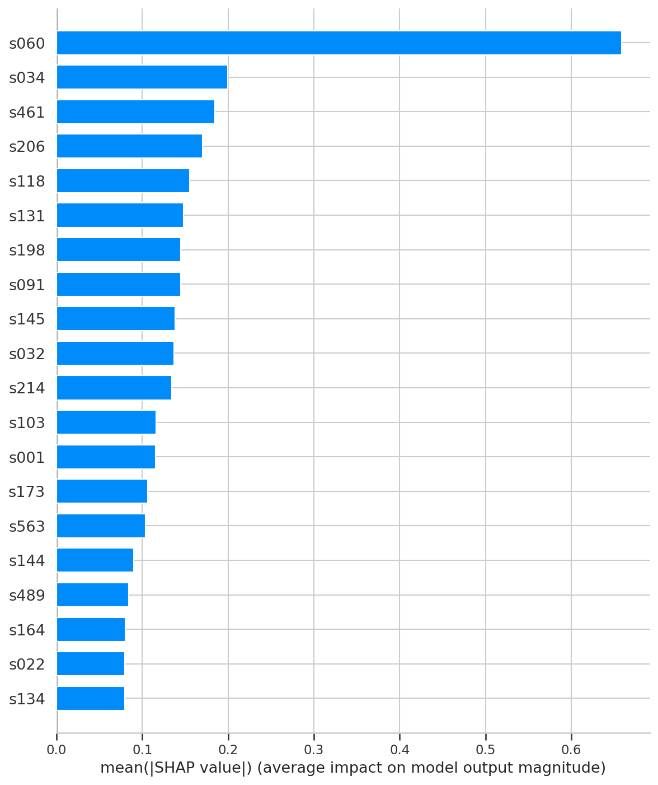

# Semiconductor Yield Prediction on Real Fab Data (SECOM)

Can process sensor readings warn us which production lots will fail the final quality test, so engineers inspect only the risky lots? This project tries to answer that question on **real data** from a semiconductor manufacturing line, using an honest, leakage-safe workflow and a business-cost view of the results.

The dataset is the [UCI SECOM dataset](https://archive.ics.uci.edu/dataset/179/secom): 1,567 production lots, 590 anonymised sensor readings per lot, a pass/fail label and a timestamp (July to October 2008). Only 6.6% of lots fail (104 failures), about 4.5% of the sensor values are missing, and many sensors are constant or nearly duplicates of each other. This makes it a hard and realistic problem.

## Main findings

The model is **modestly better than random guessing, not a production-ready predictor**, and this README says so clearly. On the 236 newest lots (9 failures), the final XGBoost model reached a ROC-AUC of 0.70 (95% bootstrap CI 0.60 to 0.81) and a PR-AUC of 0.066 against 0.038 for random guessing. With only 9 test failures, every test number is noisy, so confidence intervals are reported instead of single scores.

The most useful signal came from ranking lots by risk. On the test set, the 118 lots with the lowest risk scores (the bottom half) contained none of the 9 failures, so inspecting only the top half would have caught all of them. At the top of the ranking the model was weak: inspecting the top 20% of lots caught only 2 of 9 failures. Because the test set is so small, treat this as an encouraging hint and not a proven result.

The failure rate also **drifted over time**: 7.1% in the training period against 3.8% in the test period. Drift like this is a major reason why models trained on the past can lose value on future data.

| Model (time-series CV on training data) | PR-AUC | ROC-AUC |
|---|---|---|
| XGBoost (tuned) | 0.190 | 0.686 |
| Random Forest | 0.153 | 0.622 |
| XGBoost (default) | 0.130 | 0.640 |
| Logistic Regression | 0.114 | 0.486 |
| Random guess | 0.071 | 0.500 |

| Inspect the top X% risky lots (test set) | Failures caught (of 9) | Lift vs random |
|---|---|---|
| 10% | 1 | 1.1x |
| 20% | 2 | 1.1x |
| 30% | 4 | 1.5x |
| 50% | 9 | 2.0x |

In the cost analysis, the cost of inspecting one lot is set to 1 unit and the cost of a missed failure is set to 5, 10, 20 or 50 units. The alert threshold is chosen on the validation set. On the test set, the model beat the best simple policy (inspect nothing or inspect everything) only when a missed failure costs 50 times an inspection (8.4% lower cost). At 10x and 20x it was worse than doing nothing, and at 5x the best choice was to flag no lots. The real costs of a fab are not in this dataset, so these ratios are assumptions.



## Approach

**Leakage-safe design.** The data is sorted by time and split chronologically: the oldest 70% of lots for training, the next 15% for validation (choosing the alert threshold) and the newest 15% for the final test. All cleaning, selection and scaling steps live inside one scikit-learn pipeline that is fitted on training data only. No oversampling was done before splitting, a mistake that inflates scores in many published SECOM studies.

**Pipeline.** Drop sensors with more than 40% missing values, impute the rest with the median, drop constant sensors, drop one sensor of every highly correlated pair (correlation above 0.95), scale, keep the best k sensors by F-test, then fit the model.

**Models.** Logistic Regression, Random Forest and XGBoost were compared with 4-fold time-series cross-validation using PR-AUC as the main metric, because accuracy is misleading when 93% of lots pass. XGBoost was tuned with randomized search, including the number of sensors to keep.

**SQL analysis.** The lot table was loaded into SQLite and queried with window functions (rolling 4-week failure rate), NTILE groups (missing-sensor quartiles) and CASE logic (shift-wise failure). Failure rates by shift were similar (6.3% to 7.0%), but the monthly rate moved a lot (9.2% in August, 2.9% in September), which is the drift mentioned above.

**Explainability.** SHAP values show which sensors drive the predictions. One sensor (s060) dominated, with a mean absolute SHAP value about three times larger than the next sensor. Sensor names are anonymised in SECOM, so in a real fab engineers would trace these IDs to physical process steps.



## Repository structure

```
notebooks/secom_yield_prediction.ipynb   full analysis, runs end to end in Google Colab
app/streamlit_app.py                     web app to score uploaded lots
app/predict_utils.py                     file reading and scoring helpers
model/                                   saved pipeline, custom transformers and config
results/                                 metrics, SQL outputs, figures, summary.json
data/README.md                           how to get the raw data
```

## How to run

**Notebook (easiest).** Open `notebooks/secom_yield_prediction.ipynb` in Google Colab and choose Runtime > Run all. It downloads the data from UCI by itself and takes about 5 minutes.

**Web app on your computer.**

```bash
git clone https://github.com/<your-username>/secom-yield-prediction.git
cd secom-yield-prediction
pip install -r requirements.txt
streamlit run app/streamlit_app.py
```

Then upload the raw `secom.data` file from UCI (or a CSV with the header `s001 ... s590`) to get a risk score for every lot. The saved model was trained with scikit-learn 1.6.1, so keep that version.

## Limitations and next steps

The test set has only 9 failures, so the results have wide uncertainty. The dataset covers about three months from one line, the sensors are anonymised, and the cost ratios are assumptions. Possible next steps are using the pattern of missing values as a feature (missingness often reflects which process step a lot went through), testing anomaly-detection models, adding drift monitoring, and repeating the analysis on a larger real manufacturing dataset.

## Data source

McCann, M. and Johnston, A. (2008). SECOM. UCI Machine Learning Repository. https://archive.ics.uci.edu/dataset/179/secom

## Author

Akash Dathaprasad, MS in Data Science, University of North Florida.

Code is released under the MIT License.
